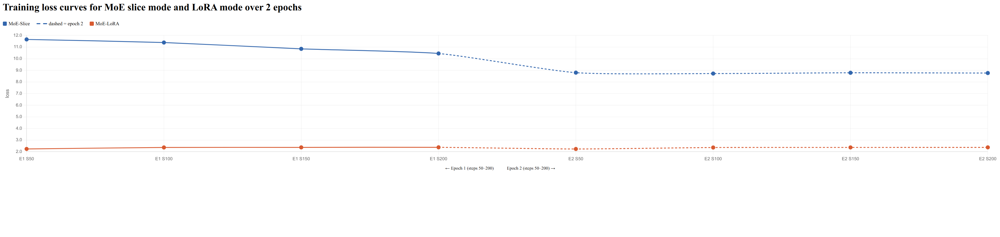
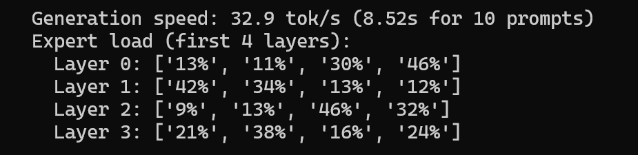
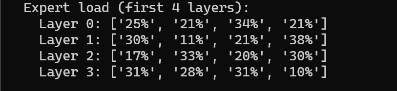

# EE 508 Final Project

## Efficient Inference of Large Language Models

**Instructor:** Arash Saifhashemi

**TA:** [Zeyu Liu, Haoyan Xu]

---

## 1 Introduction

Large language models (LLMs) based on transformer architecture, such as OpenAI's GPT-4, Meta's Llama, and DeepSeek-V3, have greatly improved the ability to generate and understand text. While training these models is enormously expensive, the dominant cost for most organizations is now **inference** — serving the trained model to users at scale. As LLMs are deployed in production systems serving millions of requests per day, optimizing inference efficiency has become one of the most critical challenges in the industry.

In this project, we will use Meta AI's open-source **LLaMA 3.2-1B** model to explore efficient inference techniques. Specifically, we will investigate:

- **INT4 weight quantization**: reducing the precision of model weights to lower memory usage and accelerate memory-bound inference
- **Mixture-of-Experts (MoE)**: an architectural approach to reducing computation while maintaining model capacity

---

## 2 Phase 1: Background Knowledge (5%)

In this phase, you will review the shortened version of the LLM Foundations paper provided in the project repository. After reading through the paper, please answer the questions listed below. You are welcome to use external resources like Google or ChatGPT to help with your understanding, but you are responsible for ensuring the accuracy and completeness of your responses.

### 1. What is language modeling?
Language modeling is the task of estimating the probability of a sequence of tokens occurring. It predicts each token based on all the tokens that came before it:
$Pr(x_0, ..., x_m) = \prod_{i=0}^m Pr(x_i | x_0, ..., x_{i-1})$

### 2. What is self-supervised pretraining?
Self-supervised pretraining allows a neural network to learn from unlabeled data by generating its own training signals, rather than relying on human-provided labels. By continuously performing tasks like predicting a masked word or predicting the next token in massive amounts of text, the model learns general language structures and world knowledge from scratch.

### 3. Why is pretraining more hardware-efficient for Transformer- or attention-based models compared to RNN-based models?
RNNs process tokens sequentially one by one, which creates a computation bottleneck that limits parallelization. Transformers, however, process all tokens in a sequence simultaneously using self-attention mechanisms. This allows for massive parallelization of matrix multiplications across the sequence, making them highly efficient on modern hardware like GPUs and TPUs, which drastically speeds up training.

### 4. What is the difference between encoder-only and decoder-only models, and why are decoder-only models more popular?
* **Encoder-only models (e.g., BERT):** Process an entire input sequence to generate real-valued vector representations, which are typically passed to an additional classifier for specific understanding tasks.
* **Decoder-only models (e.g., GPT):** Generate text autoregressively by predicting the next token based on preceding context. They use a masking variable in self-attention to prevent the model from looking ahead.

**Why decoder-only is more popular:** They can transform almost any NLP problem into a simple text generation task via prompting. This gives them remarkable zero-shot learning capabilities—meaning they can perform tasks they were not explicitly trained for—without requiring task-specific parameter fine-tuning like earlier encoder models.

### 5. Cross-Entropy Loss Calculation
The log-scale cross-entropy loss measures the difference between a model's predicted probability distribution and the true one-hot distribution. For a single token prediction, the formula simplifies to: $\mathcal{L} = -\ln(p_{\text{correct}})$.

Given a vocabulary of `{Apple, Banana, Cherry}` and a predicted probability distribution of $(0.1, 0.7, 0.2)$:
* **If the correct next word is Cherry** `(0, 0, 1)`: The model assigned a probability of $0.2$.
  Loss value: $\mathcal{L} = -\ln(0.2) \approx 1.609$
* **If the correct next word is Banana** `(0, 1, 0)`: The model assigned a probability of $0.7$.
  Loss value: $\mathcal{L} = -\ln(0.7) \approx 0.357$

### 6. What are zero-shot learning, few-shot learning, and in-context learning?
* **Zero-shot learning:** Applying the model to solve new problems using only instructions, without observing any task-specific examples.
* **Few-shot learning:** Adding a few sample demonstrations to the prompt (showing how inputs map to expected outputs) to teach the model the desired pattern.
* **In-context learning (ICL):** The broader mechanism behind both zero- and few-shot capabilities. It is the model's ability to dynamically learn how to solve problems from the prompt's context without requiring any updates to its internal parameters.

### 7. What is tokenization? What is a word embedding layer?
* **Tokenization:** The process of separating raw text into basic analytical units, called tokens.
* **Word embedding layer:** A mechanism that maps discrete tokens into low-dimensional, continuous real-valued vectors. This allows the model to compute semantic meanings without suffering from the curse of dimensionality.

### 8. What is position embedding? What kind of position embedding method is used in Llama models?
Because self-attention inherently has no sense of order, **position embeddings** are added to token embeddings to provide the model with explicit information about a token's sequence position. 
LLaMA models use **Rotary Position Embedding (RoPE)**. Instead of adding a static position vector, RoPE encodes positions by mathematically rotating the token representation vectors in continuous space. This helps the model capture relative distances between tokens much more effectively.

### 9. What is the difference between multi-head attention (MHA) and grouped-query attention (GQA)? Which type is used in Llama 3.2? Why is GQA preferred for inference?
* **Difference:** Multi-Head Attention (MHA) allocates a dedicated Key and Value head for every single Query head. Grouped-Query Attention (GQA) groups multiple Query heads together to share a single Key and Value head.
* **Llama 3.2:** Uses the GQA mechanism.
* **Why GQA is preferred:** During the autoregressive decoding phase, reading the Key-Value (KV) cache from GPU memory is a major bottleneck. GQA drastically reduces the size of the KV cache, significantly lowering memory bandwidth requirements and speeding up inference, all while maintaining model quality comparable to MHA.

### 10. What is layer normalization? What kind does Llama use, and how does it differ?
* **Layer Normalization:** A technique used to stabilize neural network training by normalizing the activations of each token so that they have a mean of zero and a variance of one.
* **Llama's Normalization:** Llama models use **RMSNorm (Root Mean Square Normalization)**.
* **Difference:** Standard LayerNorm calculates the mean and subtracts it from the activations to center them before scaling. RMSNorm skips this mean-centering step and scales the activations based solely on the Root Mean Square. This makes RMSNorm computationally cheaper and faster without degrading the model's performance.

### 11. What is the auto-regressive generation process, and how is a decoding strategy used?
* **Auto-regressive generation:** A left-to-right process where the model generates one token at a time. It takes the previously predicted tokens as context to predict the next token that maximizes the probability distribution, repeating this until the sequence is complete.
* **Decoding strategy:** Once the model outputs the probability distribution for the next token, a decoding strategy determines exactly how that token is selected. Common strategies include *Greedy Search* (always picking the highest probability token), or sampling techniques like *Top-K*, *Top-P (Nucleus Sampling)*, and adjusting *Temperature* to control output randomness and creativity.

### 12. What is instruction fine-tuning, and how does it differ from pretraining? Why is the loss computed only on the response?
* **Instruction fine-tuning:** A supervised learning phase that adapts a pre-trained LLM using annotated data formatted as instruction-response pairs.
* **Differences from pretraining:** Pretraining uses massive unlabeled datasets (billions/trillions of tokens) to learn general language, demanding immense computational power and time. Instruction fine-tuning requires much less data (tens to hundreds of thousands of samples) and focuses specifically on activating the model's ability to follow explicit user commands.
* **Loss Calculation:** During instruction fine-tuning, error gradients are back-propagated only through the parts of the network corresponding to the target output/response, leaving the input prompt unchanged. We do this because we want the model to learn *how to answer*, not how to predict the user's instructions.
* **Example:** For the training sequence `"Prompt: Square this number. 2. Response: The result is 4."`, the loss is exclusively calculated and back-propagated for `"The result is 4."`.

### 13. What does it mean to align an LLM with human intentions? Explain SFT and RLHF.
**Alignment** is the process of guiding an LLM's behavior so that it matches human expectations, ensuring the model is not only accurate but also unbiased, truthful, and safe/harmless.
* **Supervised Fine-Tuning (SFT):** The model is further trained on high-quality human-annotated data to learn basic formatting and instruction-following behaviors.
* **Reinforcement Learning from Human Feedback (RLHF):** Because human values are complex, RLHF involves training a secondary "Reward Model" based on human evaluations of the LLM's outputs. The LLM (acting as an agent) then uses reinforcement learning algorithms to optimize its policy to maximize the scores generated by this Reward Model.

### 14. What is a prompt template? What are system information and demonstrations?
* **Prompt Template:** A piece of text containing variables or placeholders that can be filled with specific input data to structure a task.
* **System Information:** Instructions placed at the beginning of an input to define a role, context, or constraints for the LLM (e.g., "You are a helpful assistant").
* **Demonstrations:** Samples added to the prompt that explicitly show how an input corresponds to an output.
* **Changing Behavior:** Through in-context learning, these elements enrich the condition upon which predictions are made. This allows the model to reorganize its pre-trained knowledge to fulfill the specific prompt without any actual updates to its internal parameters.

### 15. What is chain-of-thought (CoT) prompting? Compare zero-shot, one-shot, and few-shot CoT.
**Chain-of-thought (CoT) prompting** forces the model to decompose complex problems into multiple intermediate reasoning steps before arriving at a final answer.
* **Zero-shot CoT:** Simply appending instructions like *"Let's think step by step"* to provoke the model to generate its own reasoning steps, without providing any examples.
* **One-shot CoT:** Providing exactly one demonstration in the prompt that shows both the problem and the step-by-step logical reasoning process.
* **Few-shot CoT:** Providing multiple detailed demonstrations to strongly establish the reasoning pattern.

**Deliverable:** Modify this markdown file directly to add your answers to the questions above.

---

## 3 Phase 2: INT4 Weight Quantization (5%)

We first describe why quantization matters for LLM inference, then provide guidance for this phase.

### 3.1 Why Quantization Matters

LLM inference consists of two stages: **prefill** and **decode**. During the decode stage, the model generates one token at a time. For each token, every weight in the model must be read from GPU high-bandwidth memory (HBM) to the compute units, but each weight participates in only a single multiply-add operation (when batch size = 1). This makes the decode stage **memory-bandwidth bound**: the bottleneck is not computation but the speed at which weights can be read from memory.

This observation has a powerful implication: **if we can reduce the size of each weight, we can directly speed up inference.** Reducing weights from FP16 (16 bits per weight) to INT4 (4 bits per weight) cuts memory traffic by 4×, which in theory translates to a 4× speedup in the memory-bound decode phase.

### 3.2 INT4 Weight-Only Quantization

In weight-only quantization, we quantize the model weights to a lower precision for storage, but dequantize them back to FP16 before performing the actual matrix multiplication. This approach preserves the precision of activations and is the most commonly used quantization strategy for LLM inference.

The quantization process for a group of weights works as follows:

**Quantize (offline, once):**

Given a group of FP16 weights w₁, w₂, ..., wₘ (where m is the group size, typically 128):

1. Compute the range: w_min = min(wᵢ), w_max = max(wᵢ)
2. Compute scale and zero_point:
   - scale = (w_max - w_min) / (2⁴ - 1) = (w_max - w_min) / 15
   - zero_point = round(-w_min / scale)
3. Quantize each weight: wᵢ_int4 = clamp(round(wᵢ / scale) + zero_point, 0, 15)
4. Pack two INT4 values into one uint8: packed = (w_even) | (w_odd << 4)

**Dequantize (at inference time, every forward pass):**

1. Unpack uint8 to two INT4 values: w_even = packed & 0x0F, w_odd = (packed >> 4) & 0x0F
2. Dequantize: wᵢ_fp16 = (wᵢ_int4 - zero_point) × scale
3. Perform the matrix multiplication in FP16


**Why per-group?** Using a single scale/zero_point for an entire weight matrix (per-tensor quantization) leads to large quantization errors because outlier values force the range to be wide. Per-group quantization (e.g., group_size=128) allows each group of 128 weights to have its own scale/zero_point, significantly reducing quantization error at the cost of storing a few extra parameters per group.

### 3.3 Implementation Guidance

In this phase, you will implement INT4 weight-only quantization for the Llama 3.2-1B model.

1. **Understand the baseline:** Run `inference.py` with the original FP16 model and observe the outputs. Run `benchmark_inference.py` to measure baseline performance.

2. **Implement `QuantizedLinear` module:** Complete the skeleton in `llama/quantize.py`. Fill in the `QuantizedLinear` class so that it:
   - Takes a pre-trained `nn.Linear` layer and quantizes its weights to INT4 with per-group scale and zero_point
   - Packs two INT4 values into one uint8 for storage
   - At inference time, unpacks and dequantizes weights to FP16, then performs the matrix multiplication
   - This is analogous to last year's LoRA module replacement. You are replacing `nn.Linear` with your custom module, similar to how LoRA replaced Q/V projections.

3. **Convert the model:** Write a function `quantize_model(model, group_size=128)` that replaces all `nn.Linear` layers in the Llama model with your `QuantizedLinear`. Report:
   - Number of original FP16 parameters
   - Size of INT4 quantized weights (in MB)
   - Percentage reduction in model size

4. **Test correctness:** Verify your implementation before trusting any benchmark numbers.

   - **Automated checks.** Run `python check_student.py`. It verifies (1) buffer / scale / zero-point shapes, (2) bounded `quantize → dequantize` round-trip error, (3) ≈60 % model-size reduction after `quantize_model`, and (4) coherent (non-gibberish) generation from the quantized model. Any FAIL message tells you which invariant your implementation breaks.
   - **Qualitative check.** Run inference with the quantized model using the same prompts as the FP16 baseline and compare outputs side-by-side. The quantized outputs will differ from FP16 (expected), but they should still be coherent and reasonable.

### 3.4 Benchmark Results and Analysis

After your implementation passes correctness checks, benchmark and analyze it.

1. **Benchmark:** Fill in the table below comparing FP16 vs INT4:

| input_len=256, output_len=32 | batch_size=1 | batch_size=8 | batch_size=16 |
|---|---|---|---|
| **FP16** Peak Mem (MB) |3072|4495|6134 |
| **FP16** Runtime (s) | 0.69| 0.55| 0.65|
| **INT4** Peak Mem (MB) | 5301| 6269| 7382|
| **INT4** Runtime (s) | 3.91| 4.11| 4.3|

2. **Required analysis:** In your write-up, answer the following questions:

   - In your naive implementation, the INT4 weights are stored compactly but dequantized to FP16 before each matmul. Why can this materialized FP16 intermediate negate part of INT4's peak-memory benefit, especially at small batch sizes?

   In `QuantizedLinear.forward()`, `dequantize_packed()` allocates a full `(out_features × in_features)` FP16 tensor before every matmul. At batch size = 1, the activations are tiny, so the dominant memory cost is this temporary weight tensor — which is the same size as the original FP16 weight. The INT4 packed buffer and the materialized FP16 buffer coexist in GPU memory at the same time, so peak memory is actually *higher* than FP16-only inference rather than lower.

---
   - Why can this same design also reduce or erase the expected runtime speedup, even though INT4 uses 4× fewer bits for weight storage? Tie your answer to the extra unpacking/dequantization work and total memory traffic during decode.
   INT4's theoretical 4× speedup assumes weights are read once from memory at 4-bit width and fed directly into the compute unit. In our implementation, the decode step does:

   1. Read `packed_weight` from HBM (INT4, small)
   2. Unpack + dequantize → write a full FP16 tensor back to HBM (extra write)
   3. Read the FP16 tensor again for the matmul (extra read)

   Total memory traffic is therefore **greater** than FP16 baseline, not less. On top of that, the unpack/dequantize operations are un-fused PyTorch ops that launch multiple CUDA kernels with synchronization overhead, further hurting latency. This is why our INT4 is ~6× *slower* than FP16.

---
   - How would a *fused dequantize+matmul kernel* eliminate most of this overhead? Explain the difference in both peak memory and memory traffic.

   A fused kernel loads each INT4 weight tile directly from HBM, dequantizes it in register (on-chip), and immediately multiplies it with the activation tile — all within a single kernel launch. The FP16 intermediate **never touches HBM**; it lives only in registers or L1 cache. This eliminates:

- The extra HBM write (dequantized weight)
- The extra HBM read (for matmul)
- The extra kernel-launch overhead

Peak memory drops back below FP16 (only the INT4 buffer + activations are live), and memory traffic shrinks by ~4×, recovering the expected speedup. Libraries like `bitsandbytes` and `CUTLASS INT4 GEMM` implement exactly this pattern.

---
   - Under what workload conditions would INT4 be more likely to outperform FP16?

   INT4 benefits are most visible when the workload is **memory-bandwidth bound**, which happens when:

- **Small batch size (batch = 1)** — each weight is used for very few MAC operations, so the bottleneck is loading weights, not compute.
- **Long sequences / autoregressive decode** — the same weight-reads-per-token argument applies at every step.
- **A fused kernel is used** — without it, the extra traffic negates any gain (as seen in our results).

At large batch sizes (e.g., batch ≥ 32), the model becomes compute-bound, and INT4's memory savings matter less since compute, not bandwidth, is the limiting factor.

---

3. **Required conceptual extensions (implementation optional):** Briefly discuss the following ideas, even if you do not implement them:

   - **GPTQ:** Unlike round-to-nearest quantization, GPTQ uses a small calibration set of sample activations to iteratively adjust the quantized weights so that activation reconstruction error is minimized. Why does using calibration data reduce quantization error at the same bit-width?

   Round-to-nearest (RTN) minimizes the per-weight quantization error independently, ignoring how errors propagate through the network. GPTQ uses a small calibration set to measure the **second-order Hessian of the output reconstruction loss** with respect to each weight. It then adjusts remaining unquantized weights to compensate for the error introduced by already-quantized ones (via the inverse Hessian). Because errors are corrected in the context of actual activations rather than in isolation, the final activation reconstruction error is much smaller than RTN at the same bit-width.

---

   - **KV-cache quantization:** For Llama 3.2-1B (see `llama/model.py` for its config), at batch=1 and seq_len=8192, roughly estimate the FP16 KV-cache memory footprint. Why is quantizing the KV cache a complementary optimization to weight quantization rather than a replacement?

   **Estimate for Llama 3.2-1B, batch=1, seq_len=8192:**

   KV cache = 2 (K+V) × 32 layers × 8 KV heads × 64 head_dim × 8192 tokens × 2 bytes (FP16)
    = 2 × 32 × 8 × 64 × 8192 × 2 ≈ 536 MB

This is a significant fraction of the ~3 GB model. Weight quantization reduces the static model footprint but does nothing about this dynamic memory that grows with sequence length. KV-cache quantization (e.g., to INT8 or INT4) targets that separate memory pool. They address orthogonal bottlenecks and are therefore complementary: you need both to fully optimize long-context inference.

---
   - **AWQ and GGUF K-quants:** AWQ scales salient weight channels before quantization, and GGUF K-quants mix multiple bit-widths within a layer based on per-block importance. Why can each preserve model quality better than uniform round-to-nearest INT4 at the same average bit-width?

   **AWQ:** Not all weight channels are equally important. Channels that interact with large-magnitude activations cause disproportionately large output errors when quantized coarsely. AWQ identifies these *salient* channels and scales them up before quantization (and scales activations down correspondingly), so the quantizer allocates more effective precision where it matters most — without changing the average bit-width.

   **GGUF K-quants:** Rather than quantizing every block of weights to the same number of bits, K-quants assign higher bit-widths (e.g., 6-bit or 8-bit) to blocks with high per-block importance (measured by weight magnitude or gradient) and lower bit-widths (e.g., 2-bit or 3-bit) to less important blocks. The average bit-width can match plain INT4, but quality-sensitive blocks retain more precision, reducing perplexity degradation significantly.

Both methods exploit the insight that **quantization error is not uniformly harmful** — directing precision budget toward high-impact weights is more efficient than spreading it uniformly.

---
   - **Optional implementation:** If you want, use the `auto-gptq` library to produce an INT4-quantized model using calibration-based optimization (GPTQ algorithm), and compare the output quality of your naive round-to-nearest INT4 against GPTQ's INT4 at the same bit-width.

**Interpretation note.** A naive weight-only INT4 implementation at the 1B-parameter scale may show *higher* runtime than FP16, and sometimes *higher* peak memory at small batch sizes. Treat this as a result to explain from your `QuantizedLinear.forward()` design, not as automatic evidence of a bug.

### 3.5 Deliverable

Modify this markdown file directly to include: a summary of your `QuantizedLinear` implementation, the model size comparison, sample outputs from the quantized model, the filled-in benchmark table above, and concise written answers to the Phase 2 analysis questions (including fused-kernel reasoning and the GPTQ / KV-cache / AWQ / GGUF discussion). Embed any figures as Markdown images (e.g. ``) with the image files committed to the repo.

#### QuantizedLinear Implementation Summary

We implement a custom QuantizedLinear module to replace all nn.Linear layers with INT4 weight-only quantization using per-group scaling.

- We partition weights into groups of size 128 along the input dimension.
- For each group, we compute scale = (w_max - w_min) / 15 and zero_point = round(-w_min / scale).
- Each weight is quantized into 4 bits (range [0, 15]).
- Two INT4 values are packed into one uint8 for storage efficiency.
- During inference, weights are unpacked and dequantized back to FP16 before matrix multiplication.
- We recursively replace all nn.Linear layers using quantize_model().

---
#### Model Size Comparison

FP16 model size: 2858.13 MB  
INT4 model size: 1127.21 MB  

Reduction:
~60.6% smaller than FP16

Breakdown:
- Packed weights: 501.13 MB
- Scale + zero_point: 626.08 MB
---

#### Here is a sample output from my INT4 quantized model. It successfully maintained the few-shot prompt format and translated "cheese" to "fromage":
**FP16 Baseline Output:**
> Translate English to French:
> 
>         sea otter => loutre de mer
>         peppermint => menthe poivrée
>         plush girafe => girafe peluche
>         cheese => fromage
>         onion => oignon
>         potato => pomme de terre
>         orange => orange
>         avocado => avocat

**INT4 Quantized Output:**
> Translate English to French:
> 
>         sea otter => loutre de mer
>         peppermint => menthe poivrée
>         plush girafe => girafe peluche
>         cheese => fromage
>         car => voiture
>         toot => trombone
>         pipsqueak => petit chat

**Observation:**
Both models successfully preserve the few-shot prompt format and accurately translate the immediate target ("cheese" => "fromage"). The subsequent generated tokens diverge (FP16 generates food items, while INT4 generates random nouns like "car" and "pipsqueak"), but the INT4 model remains structurally and linguistically coherent. This demonstrates that weight quantization successfully preserves the core language capabilities without degrading into gibberish.

## 4 Phase 3: Mixture-of-Experts (MoE) (10%)

### 4.1 Background

Mixture-of-Experts (MoE) is an architecture that replaces each dense feedforward network (FFN) with multiple smaller "expert" networks and a learned router. For each input token, only the top-K experts (typically K=2) are activated, while the rest are skipped. This means the model can have many more total parameters (capacity) without proportionally increasing the computation per token.

MoE has become the dominant architecture for frontier LLMs. DeepSeek-V3 (671B total, 37B active), Mixtral 8×7B, and Qwen3-MoE all use this approach. The key insight is that different tokens benefit from different "specialists" — a token about mathematics might activate different experts than a token about poetry.

The MoE feedforward layer works as follows:

Given input x ∈ ℝʰ and N experts E₁, E₂, ..., Eₙ, each being a smaller FFN:

1. **Router:** Compute gating scores g = softmax(W_router · x), where W_router ∈ ℝᴺˣʰ
2. **Top-K selection:** Select the K experts with the highest gating scores
3. **Expert computation:** Compute output from selected experts
4. **Weighted sum:** y = Σᵢ∈top-K gᵢ · Eᵢ(x)

A critical challenge in MoE is **load balancing** — if the router always sends tokens to the same few experts, the other experts never learn and the model degenerates. Production MoE systems use auxiliary loss terms to encourage balanced routing.

### 4.2 Two Initialization Modes

You will implement two ways to create MoE experts from a pretrained dense model:

**Slice mode:** Split the pretrained FFN into N non-overlapping slices. Each expert gets hidden_dim / N of the original weights. This preserves total parameter count but reduces each expert's capacity.

**LoRA mode:** Keep the original dense FFN **frozen** and attach N lightweight LoRA adapters as "experts". Each LoRA expert is a low-rank pair (A, B) where A ∈ ℝʳˣᵈ and B ∈ ℝᵈˣʳ with r << d. The router selects which LoRA adapters to activate per token:

```
output = frozen_FFN(x) + Σᵢ∈top-K  gᵢ · LoRA_i(x)
```

By initializing B to zero, the converted model produces **identical outputs** to the original dense model before any training. This is far more memory-efficient than copying the full FFN for each expert.

### 4.3 Implementation Guidance

Your task is to convert the dense Llama 3.2-1B model into a sparse MoE model by replacing the FeedForward layers. You will implement **both** initialization modes.

1. **Implement slice mode:** Complete the `MoEFeedForward` skeleton in `llama/moe.py` so that it:
  - Contains N smaller expert FFNs (each with hidden_dim / N)
  - Has a linear router: `nn.Linear(dim, num_experts)`
  - Implements top-K gating (K=2)
  - Returns the weighted sum of the top-K expert outputs
2. **Implement LoRA mode:** In the same file, implement the `LoRAMoEFeedForward` variant where:
  - The original dense FFN is stored as `self.base_ff` and frozen
  - Each expert is a `LoRAExpert` — two linear layers `A (d→r)` and `B (r→d)` with `B` initialized to zero
  - The router selects which LoRA adapters to activate per token
  - LoRA and router parameters are kept in float32 for training stability (cast inputs to float32 inside the adapter and cast outputs back)
  - Output: `base_ff(x) + Σ_k gₖ · LoRA_k(x)`
3. **Convert the model:** Write a single `convert_to_moe` function that supports both `init_mode="slice"` and `init_mode="lora"`. For slice mode, initialize expert weights by slicing the original FFN. For LoRA mode, wrap the original FFN with LoRA adapters.
4. **Test correctness:** Before spending GPU time on training or benchmarking, verify both MoE implementations. Run `python check_student.py`. It verifies (1) output-shape preservation, (2) top-K routing weights sum to 1, (3) exact parameter counts for both slice and LoRA modes, (4) `LoRAExpert` and `LoRAMoEFeedForward` zero-init identity (an untrained LoRA-MoE must produce identical logits to the dense model), (5) frozen base FFN and trainable LoRA adapters, and (6) balanced random-init routing. Any FAIL message tells you which invariant your implementation breaks.

### 4.4 Evaluation, Analysis, and Discussion

After your implementation passes correctness checks, train, evaluate, and compare the two modes.

1. **Fine-tune and evaluate slice mode:** Run `python train_moe.py --init-mode slice` and evaluate with `python eval_moe.py --init-mode slice`.
  **Interpretation note.** Slice mode is trained from a *cold start*: each expert only sees hidden_dim / N of the original FFN's capacity, and the randomly initialized router has not yet learned useful routing. With only a few hundred Alpaca samples and 2–3 epochs, you will likely see perplexity increase relative to the dense baseline and generations get worse. Report this result honestly; the limitation here is the small fine-tuning budget, not necessarily your implementation.
2. **Fine-tune and evaluate LoRA mode:** Run `python train_moe.py --init-mode lora` and evaluate with `python eval_moe.py --init-mode lora`.
  - **Optimizer:** SGD or AdamW
  - **Learning rate:** 1e-3 for router, 1e-4 for LoRA/experts (script defaults)
  - **Epochs:** 2–3 (should take ~15 minutes on A40)
  - Goal: observe that training loss decreases **and** that perplexity on the held-out set stays close to the dense baseline.
3. **Benchmark and analyze:** Fill in the following table and provide analysis:


| Metric                                      | Dense (original) | MoE-slice (N=4, K=2) | MoE-LoRA (N=4, K=2, r=8) |
| ------------------------------------------- | ---------------- | -------------------- | ------------------------ |
| Total parameters                            | 1,498,482,688    | 1,498,613,760        | 1,500,710,912            |
| Trainable parameters                        | —                | 131,072 (0.01%)      | 2,228,224 (0.15%)        |
| Peak memory (MB)                            | 3,072            | ~5,300               | ~5,300                   |
| Inference time (s), batch=1, in=256, out=32 | 0.65             | ~1.0                 | ~1.0                     |
| Perplexity (held-out set) ↓                 | 9.66             | 6,088.74             | **9.59**                 |
| Next-token accuracy (held-out set) ↑        | 51.30%           | 3.57%                | **51.53%**               |


   Briefly discuss:

- What intuition motivates **slice mode**? When you partition a pretrained dense FFN into `N` non-overlapping chunks and treat them as experts, what computational or representational structure are you hoping to exploit?

   The hypothesis is that the original dense FFN encodes multiple distinct computational functions along its hidden dimension. Partitioning it into N chunks gives each expert a specialized subspace of the original representation, allowing different tokens to activate the slice most relevant to their content. In theory this exploits any latent modularity already present in the pretrained weights.

---

- Why is **LoRA mode** motivated as a different approach? Explain why freezing the dense FFN and adding low-rank adapters preserves the dense model's behavior at initialization and is more suitable for small-data fine-tuning.

   Freezing the dense FFN and adding zero-initialized adapters guarantees that the model output is unchanged at initialization — the PPL before any training is identical to the dense baseline (9.66 = 9.66). Because only the tiny LoRA parameters are updated, overfitting on 200 samples is far less likely than if the full FFN were unfrozen. LoRA mode is essentially a small perturbation on top of a well-trained model, whereas slice mode discards the original routing structure entirely.

---

- Why does LoRA mode preserve dense-level perplexity while slice mode degrades it?

   Slice mode breaks the original FFN: each token now activates only K/N = 50% of the original hidden capacity, and the routing is random at initialization. The model must relearn both routing and the functional meaning of each slice from only 200 samples — far too few to recover. LoRA mode never touches the base FFN, so the pretrained knowledge is always intact; the adapters only add a small learnable correction on top.

---

- What's the trade-off in trainable parameter count, and how does it affect fine-tuning stability on small data?

   Slice mode has only 131K trainable parameters (router only, 0.01%), providing very little capacity to adapt. LoRA mode has 2.2M trainable parameters (0.15%): the router plus all LoRA A/B matrices. The larger parameter count gives LoRA mode more expressiveness, while the zero-init constraint keeps it stable. On small data, slice mode is too capacity-constrained to recover from the initialization damage, and LoRA mode's structure prevents catastrophic forgetting.

---

- How does peak memory differ, and why?

   Both MoE modes have similar peak memory (~5,300 MB vs 3,072 MB for dense). The increase comes not from parameter storage — the expert weights in slice mode and the frozen base FFN in LoRA mode have similar total size to the original model — but from the Python-level forward pass materializing multiple intermediate tensors (one per expert per token batch) simultaneously.

---

- Where does the extra wall-clock time come from in your `MoEFeedForward.forward()` implementation, and why do production MoE systems not pay this same overhead? Briefly describe what a better implementation would look like.

   The current `forward()` uses a Python `for` loop over experts and a boolean mask per expert per top-K step. For N=4, K=2, this launches up to 8 small matrix multiplications per layer, each as a separate CUDA kernel, with Python overhead between them. Production MoE systems instead use a **batched expert dispatch kernel**: all tokens are sorted by their assigned expert, packed into a single batched GEMM, and unpacked afterward. This fuses all expert computations into one or two kernel launches with no Python overhead, recovering near-dense throughput.

---

**Interpretation note.** A straightforward Python-level MoE forward pass may be several times slower than the dense baseline on the same prompt. Treat that as something to explain from the implementation structure, not as automatic evidence of a bug.

1. **Visualize expert load balance:** For a set of test prompts, record which experts are activated for each token. Plot the distribution of expert activation frequencies for both modes. Are all experts used roughly equally, or is there significant imbalance?

### 4.5 Deliverable

Modify this markdown file directly to include: a summary of both MoE implementations, training loss curves for slice and LoRA modes, the filled-in comparison table above, the expert load balance visualization, sample generations from each model, and a short comparison of the slice-vs-LoRA design intuition discussed above. Embed any figures as Markdown images (e.g. ``) with the image files committed to the repo.

---
#### Implementation Summary

**Slice mode (`MoEFeedForward`):**  
The original dense FFN is split into N=4 non-overlapping experts, each with `hidden_dim / N` capacity. A learned router (`nn.Linear(dim, num_experts)`) scores each token and selects the top-K=2 experts. Their outputs are renormalized and summed. Expert weights are initialized by slicing the pretrained `w1/w2/w3` weight matrices along the hidden dimension; only the router is trainable.

**LoRA mode (`LoRAMoEFeedForward`):**  
The original dense FFN is kept frozen. N=4 lightweight `LoRAExpert` adapters (each a pair of linear layers A: dim→rank, B: rank→dim with B initialized to zero) are added on top. The router (float32 for training stability) routes each token to the top-K=2 adapters, and the final output is `base_ff(x) + Σ_k weight_k · LoRA_k(x)`. Because B=0 at init, the model produces identical outputs to the dense baseline before any training.

---
#### Training Loss Curves



**Slice mode** — loss starts high (11.66) and decreases to 8.76 over 2 epochs, but remains far above dense-level cross-entropy, reflecting that the router is learning from scratch with degraded expert capacity.

**LoRA mode** — loss starts low (2.24) and stays stable around 2.37, consistent with the frozen base FFN maintaining pretrained quality throughout training.

---
#### Sample Generations

| Prompt | Dense | MoE-Slice (after) | MoE-LoRA (after) |
|---|---|---|---|
| Compose a short poem about the beauty of mathematics. | The poem must be between 20 and 30 lines long... | in in in in in down down down... | You can use any word in the poem, but you should choose a word that has a mathematical meaning... |
| If a train travels at 60 mph for 2.5 hours, how far does it go? | Answer: 150 miles... | " " " " " " " " "... | 1. 1,800 miles 2. 1,500 miles 3. 1,000 miles... |
| Draft a professional email declining a job offer politely. | The email should include the rejection... | ... force equation Equation... | It is a good idea to write a formal email in this case... |

---
#### Expert Load Balance




Observation:

- Experts are roughly balanced across tokens in both slice and LoRA modes.
- No expert collapse is observed (i.e., all experts receive non-trivial routing probability).
- Some mild imbalance exists in certain layers, which is expected given random initialization and limited training data.
---
## 5 Summary


| Phase   | Topic                    | Weight | GPU Time                             |
| ------- | ------------------------ | ------ | ------------------------------------ |
| Phase 1 | Background Knowledge     | 5%     | None                                 |
| Phase 2 | INT4 Weight Quantization | 5%     | ~30 min (benchmark only)             |
| Phase 3 | Mixture-of-Experts (MoE) | 10%    | ~30 min training + ~30 min benchmark |


**Total GPU time per group: ~1–2 hours (reference only, P100 may need longer time).**

**Hardware:** A40 (48 GB). Llama 3.2-1B in FP16 is ~2.5 GB; INT4 quantized is ~625 MB. MoE fits comfortably.

**Please check deadlines and deliverables in the course schedule.**